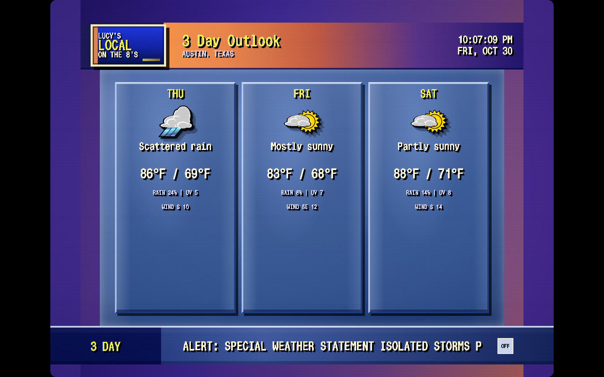
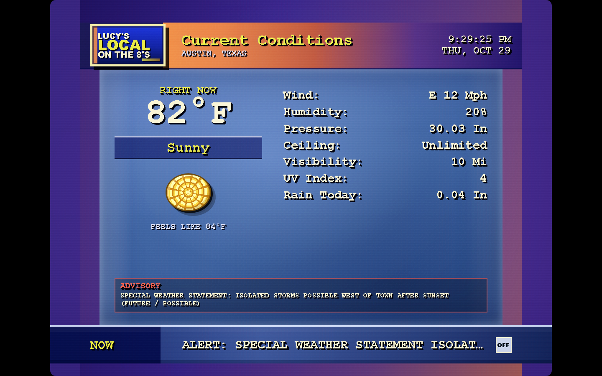
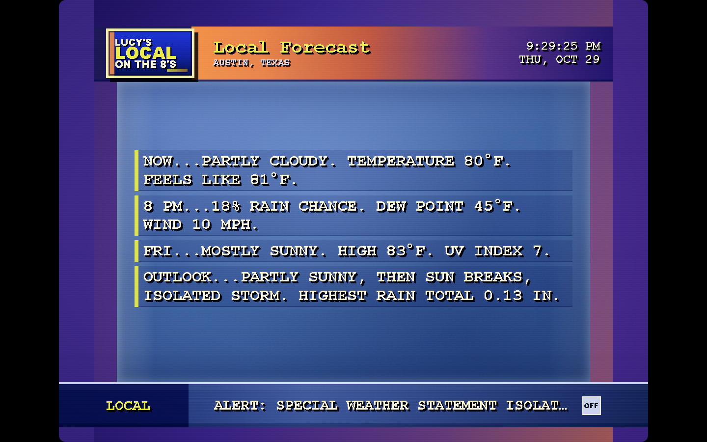
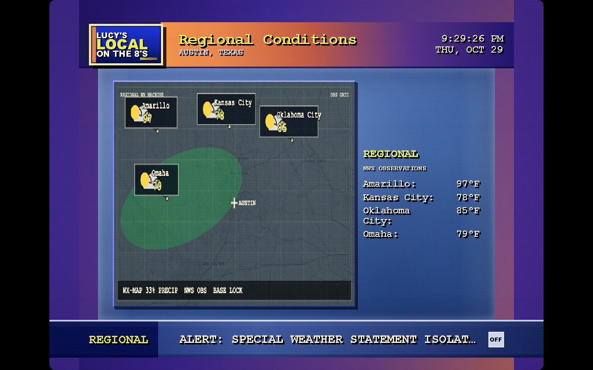
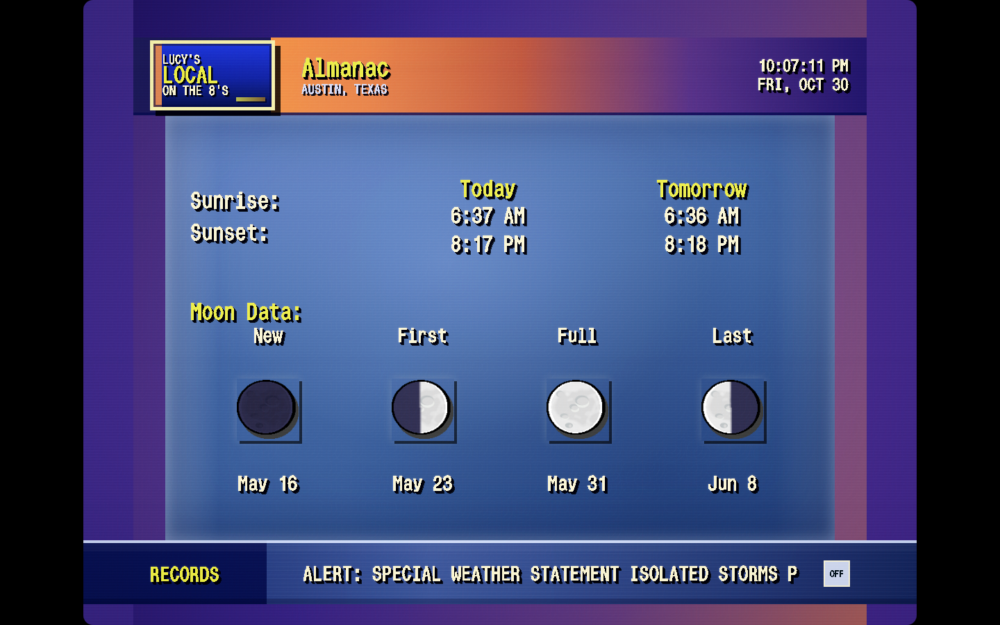
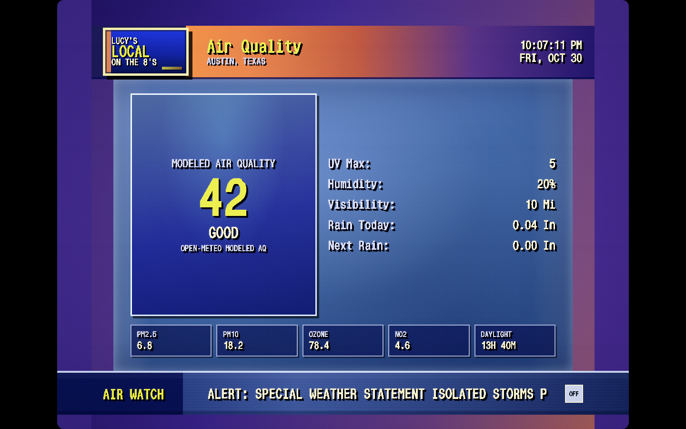
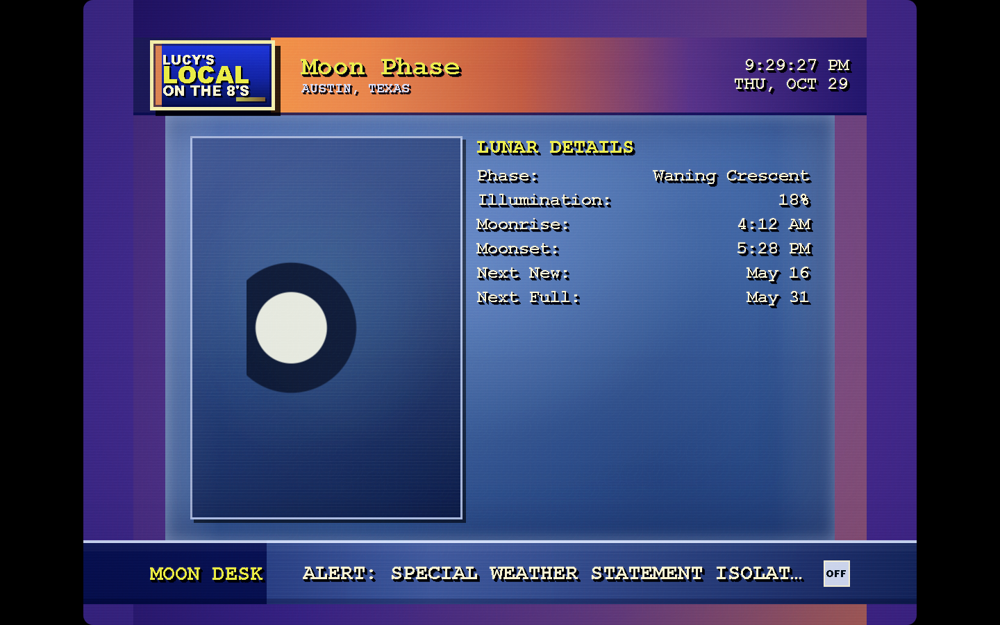
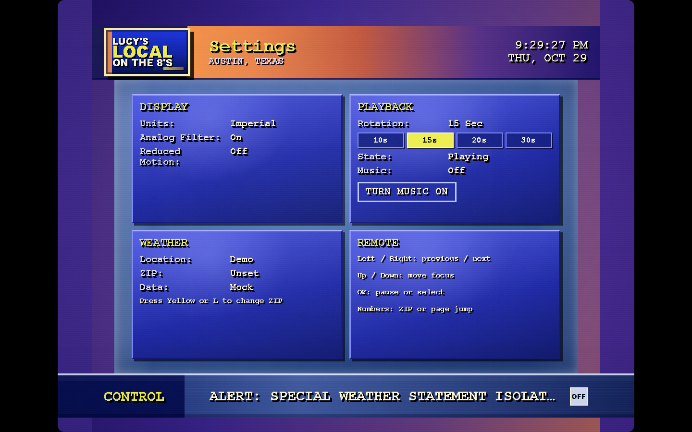
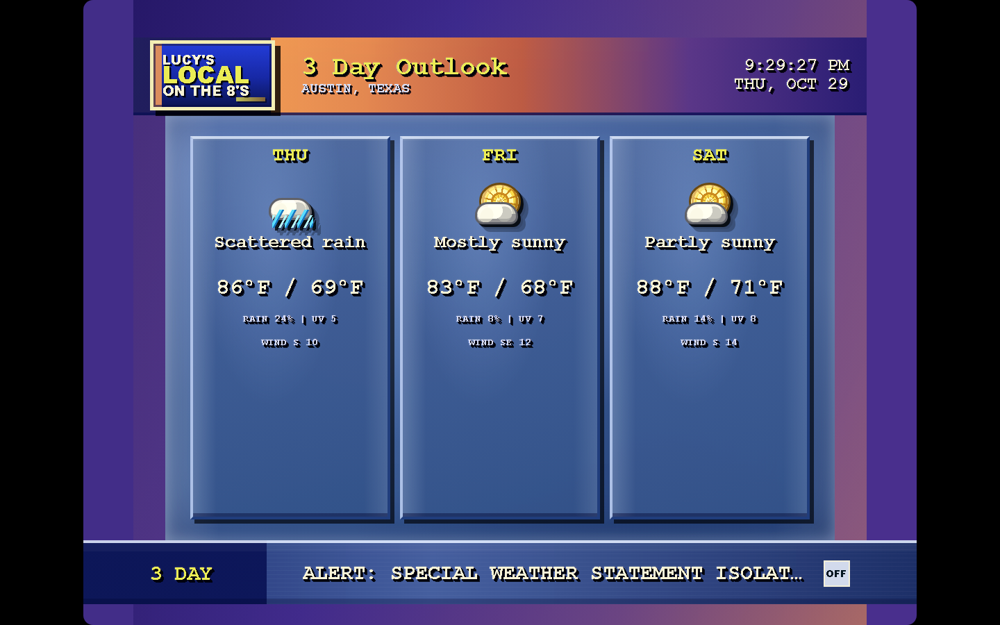

# Lucy's Local on the 8's

A vintage local weather channel for browsers and LG webOS TVs. Enter a US ZIP
code, tune in, and let the forecast rotate. Built as a static web app with no
framework, account, or application build step.



## Explore the channel

| Current conditions | Local forecast | Regional conditions |
| --- | --- | --- |
|  |  |  |

The station rotates through nine pages: **Current Conditions**, **Local
Forecast**, **3 Day Outlook**, **Regional Conditions**, **Local Radar**,
**Almanac**, **Air Quality**, **Moon Phase**, and **Settings**. The radar page
shows recent RainViewer imagery when available; it needs an internet connection.

<details>
<summary>See almanac, air quality, moon, and settings screens</summary>

| Almanac | Air quality |
| --- | --- |
|  |  |

| Moon phase | Settings |
| --- | --- |
|  |  |

</details>

All screenshots use built-in demo data; any displayed alert, observation, or
air quality reading is illustrative.

### Vintage TV effects

The optional analog filter adds scanlines, soft glow, color bleed, and subtle
noise to the 4:3 broadcast canvas. Press `S` to compare. Reduced Motion (`R`)
stops the animated effects; the Settings page shows both states.

| Analog filter on | Analog filter off |
| --- | --- |
|  |  |

### Controls

| Action | Keyboard | LG remote |
| --- | --- | --- |
| Next / previous page | `→` / `←` | Right / Left, or Channel Down / Up |
| Change a focused setting | `→` / `←` | Right / Left |
| Select a page | `1`–`9` | Number keys outside ZIP setup |
| Move focus in setup and controls | `↑` / `↓` | Up / Down |
| Activate focused button or pause playback | `Enter` / `Space` | OK |
| Open / close help | `?`, `/`, or `H` | Red button |
| Change ZIP | `L` | Yellow button |
| Toggle sound | `M` | Green button or on-screen sound button |
| Toggle reduced motion | `R` | Blue button |
| Toggle analog filter | `S` | No mapped remote button yet |
| Switch °F / °C | `U` | No mapped remote button yet |
| Fullscreen | `F` | TV app already fills the screen |
| Close overlay / exit app | `Esc` | Back |

For ZIP setup, focus the input and use the TV's native on-screen keyboard; move
focus to **Tune In** and press OK. The on-screen [controls panel](docs/screenshots/controls.png)
shows the remote shortcuts.

## Try it locally

```sh
cd app
python3 -m http.server 4173
```

Open `http://localhost:4173`, enter a five-digit US ZIP, then choose **Tune In**.
Live forecasts use Open-Meteo; NWS adds US alerts and station observations;
RainViewer supplies radar. Cached or demo weather can keep the display running
when a service is unavailable. Sound is optional and starts after interaction.

The browser preview also serves as a remote simulator. Open the controls panel
with `?` to see page numbers and remote shortcuts while the app is running.

## Put it on the web

This repo includes a GitHub Pages workflow that publishes **only `app/`**. With
the repository public and Pages set to **GitHub Actions** in Settings → Pages,
the site can appear at `https://lilscrufy.github.io/lucys-local-on-the-8s/` after
the workflow runs. GitHub Pages supports this on GitHub Free; the default URL
does not require buying a domain. A custom domain is optional. The app calls
weather providers directly from each visitor's browser, so this hosting path
does not require a server or API key.

## Put it on an LG TV

Follow [the Developer Mode installation guide](docs/INSTALL_ON_LG_TV.md). The
same `app/` directory is packaged for webOS. It has been installed on an LG C3;
other TV models and older webOS versions have not yet been verified. Developer
Mode sessions require renewal to keep sideloaded apps installed.

If you use an AI coding agent, give it this repository and ask it to follow
[`AGENTS.md`](AGENTS.md) and the TV installation guide. You still need to enable
Developer Mode and read the pairing passphrase on your TV.

## Credits and license

Code and original app graphics are MIT licensed; see [LICENSE](LICENSE). The
bundled music by Kevin MacLeod is separately licensed CC BY 4.0; see
[track credits](app/assets/audio/README.md). Music files are not covered by MIT.

Weather data: [Open-Meteo](https://open-meteo.com/) (CC BY 4.0) and
[US National Weather Service](https://www.weather.gov/documentation/services-web-api).
Radar: [RainViewer](https://www.rainviewer.com/api.html). Map data:
© [OpenStreetMap contributors](https://www.openstreetmap.org/copyright).
The free Open-Meteo service is for noncommercial use and has [usage limits](https://open-meteo.com/en/terms).

## Recreate screenshots

With the local preview server running, install Python Playwright and its
Chromium headless shell, then run `python3 scripts/capture_screenshots.py`.
The script uses demo mode, checks page titles, controls, filter state, and
browser errors, then refreshes the PNGs in `docs/screenshots/`.
